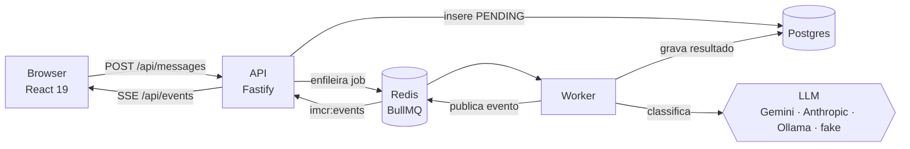

<div align="center">

# 📬 IMCR — Intelligent Message Classifier & Router

**Mensagens de clientes classificadas por IA e roteadas em tempo real para o setor certo, num quadro Kanban ao vivo.**

[](https://github.com/VRossi18/message-classfier/actions/workflows/ci.yml)
[](https://nodejs.org/)
[](https://react.dev/)
[](https://www.typescriptlang.org/)
[](https://fastify.dev/)
[](https://vite.dev/)
[](https://tailwindcss.com/)
[](https://railway.com/)

</div>

---

## ✨ O que é

O IMCR recebe mensagens de clientes, pede a um LLM que as classifique e as exibe num **Kanban em tempo real**. Para cada mensagem, o modelo devolve:

| Campo | Valores |
| --- | --- |
| **Setor** | `FINANCIAL` · `STOCK` · `SUPPORT` · `SALES` |
| **Sentimento** | `CALM` · `NEUTRAL` · `ANGRY` · `CRITICAL` |
| **Urgência** | pontuação usada no roteamento |
| **Confiança** | abaixo do limiar (`CONFIDENCE_THRESHOLD`), a mensagem vai para **revisão humana** |

Mensagens críticas ou de baixa confiança caem na coluna **Urgente**; um humano pode **corrigir o setor** e **resolver** a mensagem, e a acurácia da IA é calculada a partir dessas correções.

## 🏗️ Arquitetura



- **API e worker** são processos separados que compartilham o código de `backend/src/`; só o worker precisa das credenciais do LLM.
- **Falhas:** 3 tentativas com backoff exponencial; erros irrecuperáveis (400/401/403/404 do provedor) marcam a mensagem como `FAILED` imediatamente.
- **Tempo real:** cada mudança de estado é publicada no Redis e repassada ao navegador por **Server-Sent Events**, com *heartbeat* e reconexão automática.

## 🧰 Stack

| Camada | Tecnologias |
| --- | --- |
| **Frontend** | Vite · React 19 · TanStack Query · Tailwind CSS v4 · MSW (modo mock) · Vitest |
| **Backend** | Fastify 5 · Drizzle ORM · PostgreSQL · BullMQ · Redis · Zod |
| **LLM** | Gemini · Anthropic · Ollama · `fake` (heurística, usada em testes/CI) |
| **Infra** | Podman/Docker Compose (dev) · Railway (produção) · GitHub Actions |

## 🚀 Começando

### Pré-requisitos

- Node.js 22+
- Podman (ou Docker) com Compose — para Postgres e Redis

### Opção 1 — Só o frontend (modo mock)

Não precisa de backend: o MSW e um simulador em memória fazem o papel da API.

```bash
cd frontend
npm install
npm run dev        # http://localhost:5173
```

### Opção 2 — Stack completa

```bash
cp .env.example .env          # preencha a chave do provedor de LLM, se não usar o fake
podman compose -f podman-compose.yaml up -d --build
```

Isso sobe Postgres, Redis, a API (`:3000`) e o worker. Depois, o frontend contra o backend real:

```bash
cd frontend
echo "VITE_USE_MOCKS=false" > .env.development.local
npm install
npm run dev
```

> 💡 Com `LLM_PROVIDER=fake` tudo funciona sem chave e sem custo — ideal para explorar.

### Opção 3 — Backend local

```bash
cd backend
cp .env.example .env
npm install
npm run dev           # API
npm run dev:worker    # worker, em outro terminal
```

## ⚙️ Configuração

Principais variáveis do backend (veja [backend/.env.example](backend/.env.example)):

| Variável | Padrão | Descrição |
| --- | --- | --- |
| `LLM_PROVIDER` | `fake` | `fake` · `anthropic` · `gemini` · `ollama` |
| `GEMINI_API_KEY` / `ANTHROPIC_API_KEY` | — | Chave do provedor ativo (somente no worker) |
| `CONFIDENCE_THRESHOLD` | `0.5` | Abaixo disso a mensagem vai para revisão humana |
| `LLM_CONCURRENCY` | `5` | Jobs processados em paralelo |
| `LLM_TIMEOUT_MS` | `30000` | Timeout por chamada ao LLM |
| `DATABASE_URL` / `REDIS_URL` | — | Conexões com Postgres e Redis |
| `CORS_ORIGIN` | `http://localhost:5173` | Origem permitida pela API |

## 🧪 Testes e qualidade

```bash
# Frontend
cd frontend
npm run lint && npm run typecheck && npm test && npm run build

# Backend (os testes de integração precisam de Postgres e Redis no ar)
cd backend
npm run typecheck && npm run build && npm test
```

Para avaliar a qualidade da classificação contra casos rotulados:

```bash
cd backend
npm run llm:check   # uma chamada real ao LLM
npm run eval        # roda eval/cases.json
```

## 🚢 Deploy

A produção roda no **Railway** (Postgres, Redis, `api`, `worker` e `frontend`). O deploy é feito pelo **GitHub Actions**: a cada push na `main`, depois que os jobs de frontend e backend passam, o job `deploy` publica `api → worker → frontend` com `railway up`.

## 📚 Documentação

- [Especificação técnica](.specs/especifica_o_t_cnica_imcr.md)
- [Relatório de QA](.specs/qa-report.md)
- [Estratégia de testes](.specs/testing.md)
- [CLAUDE.md](CLAUDE.md) — guia de arquitetura e armadilhas para quem contribui

## 📁 Estrutura

```text
.
├── backend/              # Fastify + Drizzle + BullMQ (API e worker)
│   ├── src/llm/          # adaptadores: fake, anthropic, gemini, ollama
│   ├── drizzle/          # migrações
│   └── eval/             # casos rotulados para avaliar o classificador
├── frontend/             # Vite + React 19 (Kanban em tempo real)
├── .github/workflows/    # CI + deploy
├── .specs/               # especificação, QA e testes
└── podman-compose.yaml   # stack de desenvolvimento
```
